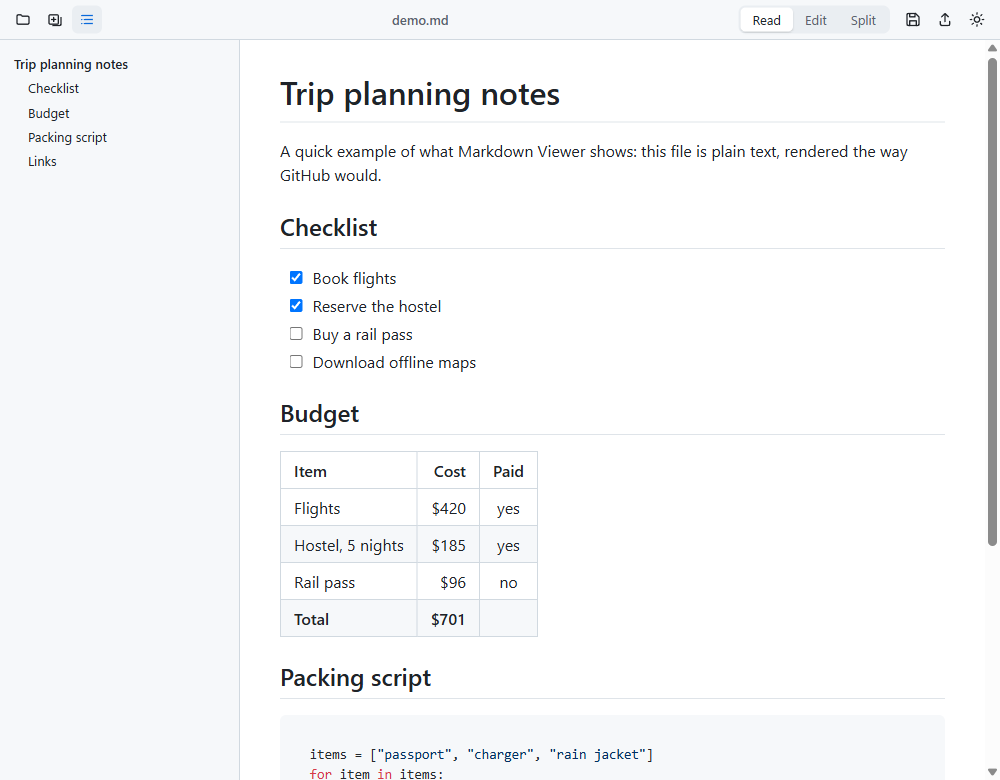
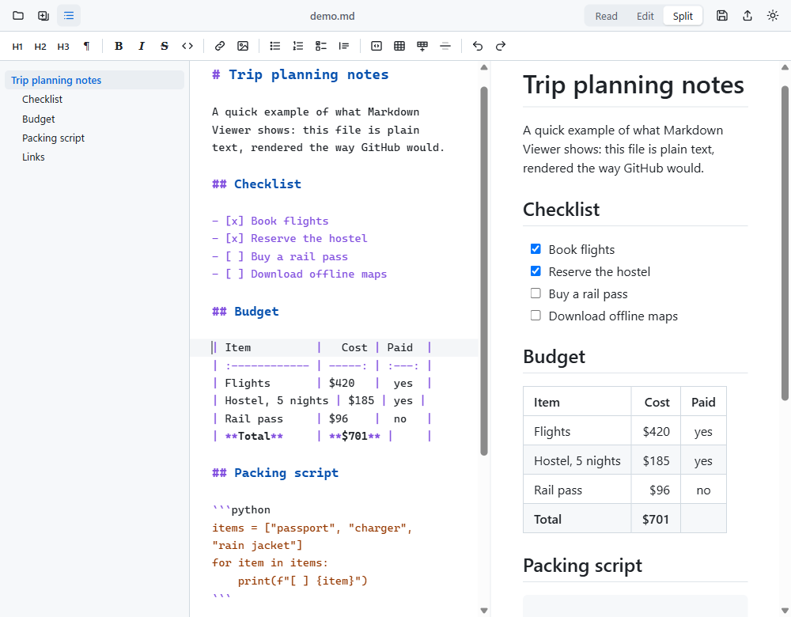
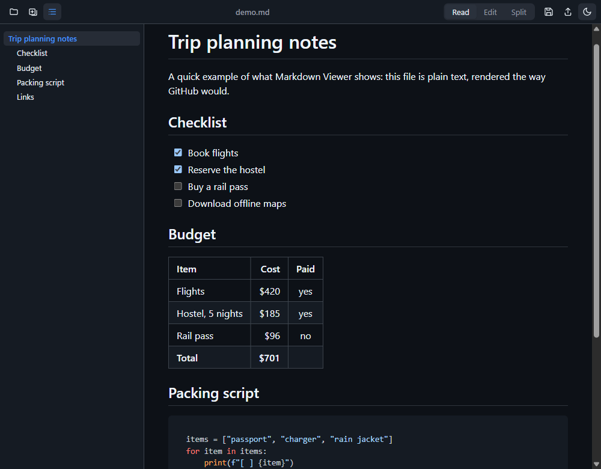

# Markdown Viewer

A **lightweight Windows tool for easy viewing and quick editing of Markdown (`.md`) files**.
Files open as a clean, rendered page (GitHub style). When you want to change something, switch to the raw text, where a **built-in formatting toolbar** handles headings, lists, links, tables and code blocks for you. You can also **export any `.md` file as PDF or HTML**.

- **Installer: about 1.5 MB** (the app itself is a 3.8 MB exe). It uses the WebView2 engine that ships with Windows 11 instead of bundling a browser.
- Starts in under a second, one window per file.

| Edit + live preview (Split) | Dark theme |
|---|---|
|  |  |

## Download

Get **`Markdown-Viewer_x.y.z_x64-setup.exe`** from [Releases](https://github.com/aurorazurary/markdown-viewer/releases).

- Per-user install, no admin rights needed.
- Windows 10/11, 64-bit. WebView2 is already part of Windows 11; on Windows 10 the installer fetches it if missing.
- The installer isn't code-signed, so SmartScreen may say "Windows protected your PC". Click **More info → Run anyway**.

### Use it as the default `.md` opener
The installer registers Markdown Viewer for `.md` and `.markdown`, and uninstalling removes this.
- If you have never picked a default app for `.md`, double-clicking a `.md` file opens it in Markdown Viewer.
- If you have, Windows keeps your choice. To switch, right-click a `.md` file → *Open with* → *Choose another app* → **Markdown Viewer** → **Always**.

## Features

- **Read view by default:** GitHub-flavoured Markdown (tables, task lists, strikethrough, syntax-highlighted code, local images). Tick task-list boxes right in the rendered page.
- **Edit** (raw text) and **Split** (raw text + live preview) modes, with a CodeMirror editor.
- **Formatting toolbar:**
  - Headings H1–H3, bold, italic, strikethrough, inline code.
  - Links, images, bullet / numbered / task lists, quotes, code blocks, horizontal rule, undo / redo.
  - **Tables:** insert one, **convert selected lines** (tab, comma, `|` or multi-space separated) into a table, tidy up the table under the cursor, or add a row.
- **Export to PDF** (A4, light theme) or a **standalone HTML** page.
- **Safe saving:**
  - Closing with unsaved changes asks first.
  - When another program changes the open file, the view reloads automatically. If you have unsaved edits, it asks instead of overwriting them.
  - Line endings (CRLF/LF) are preserved.
- **Navigation:** outline sidebar of headings and find in page (Ctrl+F).
- **Look:** theme follows Windows light/dark, or force either one; zoom with Ctrl +/−.
- **Opening files:** drag & drop, or pass a file path on the command line.

| Shortcut | Action | Shortcut | Action |
|---|---|---|---|
| Ctrl+O | Open | Ctrl+E | Read ↔ Edit |
| Ctrl+N | New window | Ctrl+\ | Split view |
| Ctrl+S / Ctrl+Shift+S | Save / Save as | Ctrl+F | Find |
| Ctrl+P | Export PDF | Ctrl+Shift+O | Toggle outline |
| Ctrl+W | Close window | Ctrl + / − / 0 | Zoom |
| Ctrl+B / I / K | Bold / italic / link | Ctrl+1 / 2 / 3 | Heading level |
| Ctrl+Shift+7 / 8 / 9 | Numbered / bullet / task list | Ctrl+Shift+T | Table |

## Tech stack

| Layer | Technology |
|---|---|
| Desktop shell | [Tauri 2](https://tauri.app) (Rust) on Microsoft Edge **WebView2** |
| Native side | Rust: windows, file I/O, single-instance, PDF export via WebView2 `PrintToPdf` |
| UI | Vanilla JavaScript (ES modules), HTML, CSS; bundled with [Vite](https://vite.dev) |
| Markdown rendering | [markdown-it](https://github.com/markdown-it/markdown-it) + task lists + heading anchors, [highlight.js](https://highlightjs.org), [DOMPurify](https://github.com/cure53/DOMPurify) for sanitising, [github-markdown-css](https://github.com/sindresorhus/github-markdown-css) for styling |
| Editor | [CodeMirror 6](https://codemirror.net) with the Markdown language package |
| Installer | NSIS (via the Tauri bundler) |
| Tests | End-to-end with [Playwright](https://playwright.dev) driving the real app over WebView2's DevTools protocol |

Architecture, module map and build instructions: **[DEVELOPER.md](DEVELOPER.md)**.

## How this was made

This app was **vibe coded**: an AI coding assistant (Claude) wrote essentially all of the code, tests and docs, **without much human oversight**. The human part was the **design phase**: choosing the framework, editor, theme behaviour and feature set, plus later product decisions such as switching from Electron to Tauri to shrink the installer. It is covered by automated end-to-end tests, but hasn't been through a careful human code review, so use it with that in mind.

## License

[MIT](LICENSE) © 2026 aurorazurary. You may use, copy, modify and redistribute it. Keep the copyright notice crediting the author (aurorazurary) in copies and derived works.

---

## Origin: the original idea

*Recorded 2026-10-31, before anything was built.*

A Windows app that automatically renders `.md` files and makes editing easy.
- Opens `.md` files in the **rendered view by default**
- Can switch to the **original text page** for editing
- The text page has a **toolbar** for quick formatting, e.g. turn text into a heading, insert or convert to a table (and other formatting options)

**Similar projects (checked 2026-10-31):**
- **[MarkText](https://github.com/commd-io/marktext)**: free, MIT, Electron. WYSIWYG-style live preview plus a source mode. Its default is a single live-rendered editing view rather than "rendered view first, then a separate text page with a toolbar".
- **[Markdown Monster](https://github.com/RickStrahl/MarkdownMonster)**: Windows Markdown editor with a formatting toolbar and synced preview. Licensed software that needs registration. Editor + preview side by side, not rendered-by-default.
- Typora (commercial, not on GitHub): seamless live preview.
- **Gap this fills:** a lightweight Windows viewer that opens as a clean rendered page, with raw text + toolbar one keystroke away. Existing tools are editor-first.
